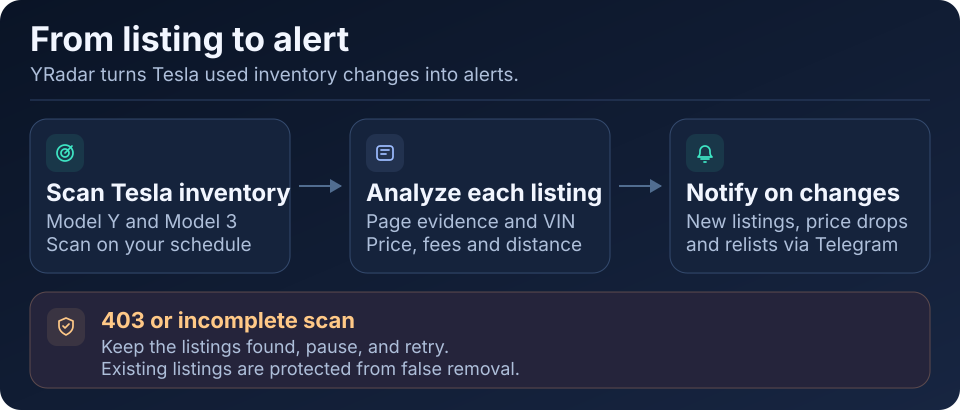

# YRadar


**Real-time configuration intelligence and alerts for Tesla's official used Model Y and Model 3 inventory.**

[中文说明](README.zh-CN.md) · [Buyer's guide](docs/buyers-guide.md) · [Filters and evidence](docs/filters.md) · [Contributing](CONTRIBUTING.md)

YRadar watches Tesla's official used inventory, enriches each listing with page evidence and model-specific VIN heuristics, records changes, and alerts you after a completed scan. Model Y has deeper hardware analysis today; Model 3 is supported without reusing Model Y-specific 2023 thresholds.

Its private predecessor helped the author buy a car they wanted. This public package contains no purchase VIN, listing, price, location, browser profile, database, logs, or credentials.

## Highlights

| | Capability |
|---|---|
| 🛰️ | **Configurable scans and durable alerts.** New listings, price drops, relists, and listings no longer observed go to Telegram or the console after a scan. Default interval: 15 minutes. |
| 🧾 | **Page evidence plus VIN analysis.** Evidence keeps its source; VIN heuristics add year and likely hardware, lights, wheels, and seats. Page evidence wins when sources disagree. |
| 🛡️ | **Block-aware recovery.** A 403 or Access Denied response triggers backoff and retry. An incomplete scan cannot make the entire inventory appear gone. This does not promise automatic repair for every future Tesla change. |
| 🚚 | **Transport fee with honest unknowns.** YRadar uses Tesla's direct fee when present or estimates from Tesla mileage bands. Show sticker plus fee or a combined estimate; unknown stays unknown. |
| 📍 | **Straight-line distance.** Bundled Southern California coordinates provide great-circle distance from your pin. `92092` is an example ZIP; this is not driving distance. |



## Quick start

Requires Python 3.10+ and Google Chrome.

```bash
python -m venv .venv
# Windows: .venv\Scripts\activate
# macOS/Linux: source .venv/bin/activate
pip install -r requirements.txt
```

Copy `.env.example` to `.env`, then edit it. The example uses `92092`; provide coordinates for distance and fee estimates.

```bash
python monitor.py --demo    # offline synthetic output; no browser, network, secrets, or user DB
python monitor.py           # one live scan
python monitor.py --loop    # continuous scans
python monitor.py --review  # send the current review
```

Before the first live scan, run `python warmup_tesla.py`. In the visible system-Chrome window, confirm the used-inventory list loads, complete any challenge manually, then close that Chrome window so its cookies remain in YRadar's dedicated profile. Start the monitor afterward. YRadar connects Playwright to installed Google Chrome; it does not use Playwright's downloaded Chromium.

`start.bat` starts loop mode on Windows. On macOS/Linux use `bash start.sh` (or `chmod +x start.sh` once, then `./start.sh`).

```dotenv
TESLA_MODELS=my,m3
TESLA_ZIP=92092
TARGET_LAT=32.8458529
TARGET_LNG=-117.2575702
TESLA_INTERVAL_MINS=15
MAX_MILEAGE=75000
PRICE_DISPLAY_MODE=net_plus_fee
INCLUDE_TRANSPORT_IN_SORT=false
```

The current default tiers compare sticker price. They are independent alert routes, so YRadar is not limited to white-interior cars:

| Tier | Default rule | Sticker ceiling |
|---|---|---:|
| Watch | Long Range AWD + White Interior + observed Clean state | $38,000 |
| Focus | Long Range AWD + HW4 signal | $33,000 |
| HW4 | Other vehicle with an HW4 signal | $32,000 |
| Base | Other/non-HW4 candidates retained for comparison | $32,000 |

Treat these as implementation defaults, not recommendations; edit the environment values for your market and budget.

`PRICE_DISPLAY_MODE=total` combines sticker and known/estimated transport. It is not an out-the-door price: tax, registration, order fees, insurance, finance charges, and other costs remain outside its scope.

Choose alert groups with `ALERT_TIERS=favorite,focus,hw4,other`; use `favorite` alone for the white-interior watch profile. `BASE_MAX_PRICE=32000` controls the general comparison group. Outside California, set `TESLA_REGION` and your ZIP; provide both coordinates for distance estimates. Blank coordinates use the built-in example only for ZIP 92092.

## Evidence and VIN limits

Values carry a source and, where possible, `confirmed`, `likely`, or `unknown`. A VIN cannot prove every installed component.

- VIN position 10 code `S` means model year 2025. It does **not by itself confirm** HW4 or matrix headlights.
- For 2023 Austin-built Model Y below `PA160000`, the author's shopping observations suggest roughly 20% may still have matrix headlights. This is not a validated population statistic and is never a hard exclusion rule.
- Model Y 2023 serial thresholds must not be applied to Model 3.
- Photos, listing details, service information, and inspection should override a VIN heuristic.

See [Filters and evidence](docs/filters.md) for the decision table.

For the storage, partial-scan, evidence, and notification design, see [Architecture](docs/architecture.md).

## Default watch profile

The editable starting profile is **Long Range AWD / White Interior / Clean**, model year 2023+, up to 75,000 miles. `Clean` means the Tesla query/report did not report accident or repaired status in fields YRadar observed. It is not proof of condition, title history, or absence of prior damage.

## Scope and responsible use

YRadar searches **Tesla official used inventory only**. It has no TrueCar integration. Use a reasonable interval and comply with Tesla's applicable terms and access controls. Tesla may change its pages and endpoints at any time.

This unofficial personal-research tool is not affiliated with Tesla. Hardware labels, fee estimates, inventory state, and buyer notes can be wrong or stale. Verify the vehicle and purchase terms yourself.

Live Tesla verification was not performed while preparing this public package. Run `python monitor.py --demo` first, then warm up the browser and validate a live scan locally.

## Project map

```text
monitor.py          CLI, loop, recovery, and notification orchestration
fetchers/           Tesla official inventory and page evidence
vin_hw.py           model-specific VIN heuristics
vehicle_tiers.py    configurable watch profiles
geo.py              straight-line distance
notifier.py         console and Telegram delivery
docs/               bilingual buyer and filter guides
tests/              unittest suite
```

MIT licensed; see [LICENSE](LICENSE). Coordinate attribution: [THIRD_PARTY_NOTICES.md](THIRD_PARTY_NOTICES.md). Security reports: [SECURITY.md](SECURITY.md).
