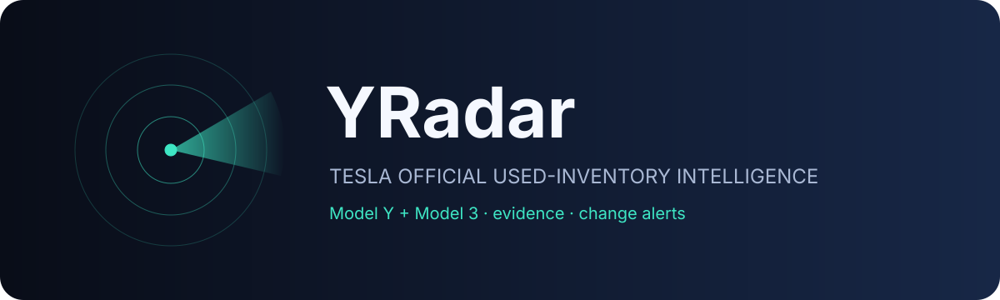
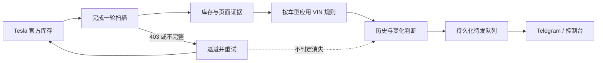

# YRadar



**Tesla 官方二手 Model Y + Model 3 的实时配置情报与提醒工具。**

[English README](README.md) · [购车指南](docs/buyers-guide.zh-CN.md) · [筛选与证据规则](docs/filters.zh-CN.md) · [参与贡献](CONTRIBUTING.md)

YRadar 定时查看 Tesla 官方二手库存，把车辆页面证据和按车型区分的 VIN 推断合并，保存变化，并在扫描结束后通知。Model Y 的硬件分析目前更深入；Model 3 也支持监控，但不会套用 Model Y 的 2023 流水号规则。

它的私人前身曾帮助作者买到心仪车辆。公开包不含成交 VIN、具体车源、价格、地点、浏览器资料、数据库、日志或密钥。

## 核心能力

| | 能力 |
|---|---|
| 🛰️ | **可调扫描与可靠提醒。** 默认每 15 分钟扫描；扫描结束后可通过 Telegram 或控制台报告新增、降价、重新出现和不再列出的车辆。 |
| 🧾 | **页面证据 + VIN 分析。** 字段保留来源，VIN 启发式补充年款及可能的硬件、灯光、轮毂和座椅；冲突时以页面证据优先。 |
| 🛡️ | **403 恢复。** 403 / Access Denied 会触发退避重试；不完整扫描不会把全站误判为下架。这不保证自动适应 Tesla 未来所有改版。 |
| 🚚 | **运费估算且保留未知。** 优先使用 Tesla 直接运费，否则按 Tesla 里程档估算；可分开显示或并入估算总价。未知不会被当成免费。 |
| 📍 | **直线距离。** 内置南加州城市坐标，计算到目标坐标的大圆距离；不是驾驶距离。`92092` 只是示例邮编。 |



## 快速开始

需要 Python 3.10+ 和 Google Chrome。

```bash
python -m venv .venv
# Windows: .venv\Scripts\activate
# macOS/Linux: source .venv/bin/activate
pip install -r requirements.txt
```

把 `.env.example` 复制为 `.env` 并编辑。示例使用 `92092`；距离和运费估算还需要坐标。

```bash
python monitor.py --demo    # 离线合成通知；不用浏览器、网络、密钥或用户数据库
python monitor.py           # 单次实时扫描
python monitor.py --loop    # 持续扫描
python monitor.py --review  # 发送当前摘要
```

第一次实时扫描前运行 `python warmup_tesla.py`：在弹出的系统 Chrome 中确认 Tesla 二手库存能正常显示；如遇挑战，手动完成；随后关闭该 Chrome，让 Cookie 保存在 YRadar 的独立资料目录，再启动监控。YRadar 通过 Playwright 连接本机 Google Chrome，不使用 Playwright 下载的 Chromium。

Windows 运行 `start.bat`；macOS/Linux 可直接运行 `bash start.sh`，或先执行一次 `chmod +x start.sh` 再用 `./start.sh`。

当前默认分档按车辆标价判断。各档都是独立的提醒入口，因此 YRadar 并非只推送白内饰：

| 分档 | 默认规则 | 标价上限 |
|---|---|---:|
| Watch | Long Range AWD + White Interior + 观察到的 Clean 状态 | $38,000 |
| Focus | Long Range AWD + HW4 信号 | $33,000 |
| HW4 | 其他有 HW4 信号的车辆 | $32,000 |
| Base | 其他/非 HW4 候选，保留用于比较 | $32,000 |

这些是当前实现默认值，不是购买建议；请按所在地和预算修改环境变量。

`PRICE_DISPLAY_MODE=net_plus_fee` 分开显示运费；`total` 合并标价与已知/估算运费。它不是完整落地价，不包括税、注册、订单费、保险或贷款费用。

## VIN 结论边界

- VIN 第 10 位 `S` 表示 2025 年款，**不能仅凭这一位确认** HW4 或矩阵大灯。
- 对 2023 Austin Model Y、`PA160000` 以下车辆，作者购车观察认为仍约有 20% 配有矩阵大灯。它不是经统计验证的总体概率，也不会成为硬过滤条件。
- Model Y 的 2023 阈值不能套到 Model 3。
- 照片、页面配置、维修资料和实车检查应覆盖 VIN 启发式推断。

完整表格见[筛选与证据规则](docs/filters.zh-CN.md)。

存储、不完整扫描保护、证据优先级和通知设计见[架构说明](docs/architecture.zh-CN.md)。

## 默认关注条件

内置条件只是可编辑起点：**Long Range AWD / White Interior / Clean**，2023 年款起，里程不超过 75,000 英里。`Clean` 只表示 YRadar 观察到的 Tesla 查询/字段没有报告事故或维修状态；它不是车况、产权或无历史损伤的证明。

## 范围与声明

本项目只检索 **Tesla 官方二手库存**，不包含 TrueCar。请使用合理扫描间隔并遵守 Tesla 适用条款与访问控制。页面和接口随时可能变化。

YRadar 是非官方个人研究工具，与 Tesla 无关联。硬件判断、运费估算、库存状态和购车经验都可能不完整或过时，请自行核验车辆与购买条件。

准备公开包时未进行 Tesla 实时联网验证。请先运行 `python monitor.py --demo`，再在本机完成浏览器预热并验证实时扫描。

MIT 许可证见 [LICENSE](LICENSE)；坐标归属见 [THIRD_PARTY_NOTICES.md](THIRD_PARTY_NOTICES.md)；安全问题见 [SECURITY.md](SECURITY.md)。

用 `ALERT_TIERS=favorite,focus,hw4,other` 选择提醒分组；只填写 `favorite` 可仅关注白内饰条件。`BASE_MAX_PRICE=32000` 控制普通候选价位。加州以外请填写 `TESLA_REGION` 与 ZIP，并提供两项坐标用于距离估算；坐标留空时，仅 ZIP 92092 使用内置示例坐标。
