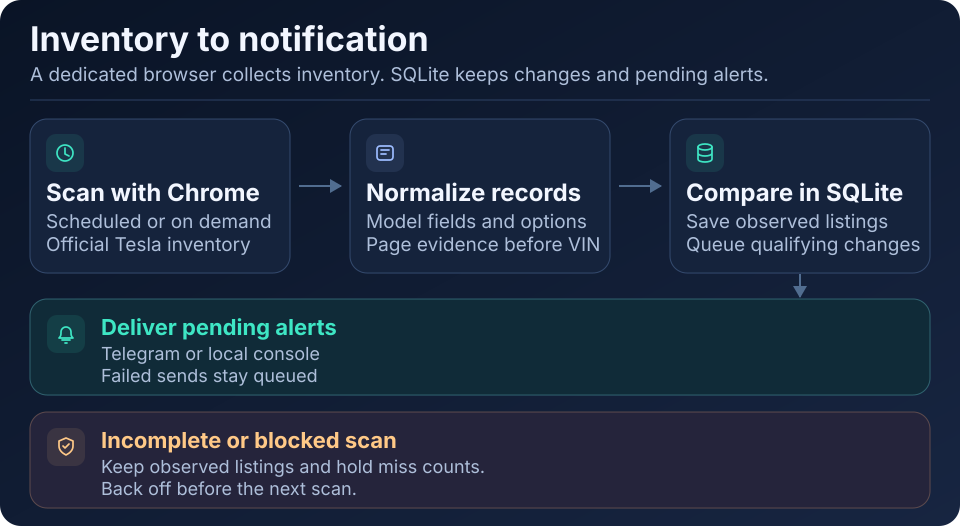
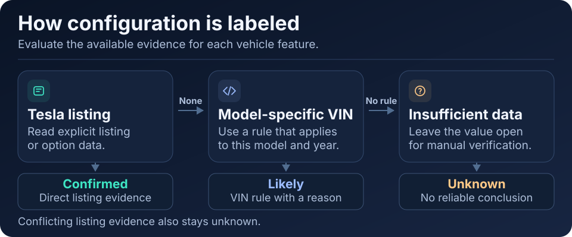

# Architecture

[中文](architecture.zh-CN.md) · [README](../README.md) · [Evidence rules](filters.md)

YRadar is a local, single-process inventory monitor. Its engineering goal is to preserve trustworthy state when the upstream page or a notification channel is unreliable.



## Scan lifecycle

1. The CLI runs once, loops at the configured interval, shows a review, or emits an isolated offline demo.
2. A dedicated system-Chrome profile opens Tesla official Model Y and Model 3 inventory through CDP.
3. Results are normalized into one record shape while retaining model, source, and reason.
4. Direct page/API evidence is resolved before model-specific VIN heuristics.
5. A complete scan updates inventory state and miss counters; an incomplete scan may store discovered rows but cannot advance disappearance state.
6. Change events enter a persistent SQLite outbox and are delivered to Telegram or printed to the console.

## Why partial scans are special

An empty response is ambiguous: the inventory could be empty, or the request could have been blocked. YRadar therefore carries a scan-completeness signal separately from the rows it found.

| Scan result | Store discovered rows | Increment missing count | Emit disappearance |
|---|---:|---:|---:|
| Complete | Yes | Yes | After configured consecutive misses |
| 403 / Access Denied | If any were parsed | No | No |
| Other incomplete failure | If any were parsed | No | No |
| Detail verification ambiguous | Keep/skip that VIN | No for that VIN | No for that VIN |

This makes a block noisy but avoids turning a network failure into a fleet-wide “sold” event. The UI uses “no longer listed” unless direct evidence supports a stronger statement.

## Evidence resolution

Every hardware/configuration conclusion should answer three questions: what value, from which source, and with what confidence.



The resolver must not reuse Model Y 2023 serial thresholds for Model 3. Model year code `S` confirms 2025 model year, not hardware by itself. Conflicting direct evidence should be visible rather than silently replaced by a heuristic.

## SQLite state and outbox

SQLite keeps the last observed listing state, price history inputs, missing counters, and notification work. The state transition and corresponding outbox item are committed together, so a process exit cannot intentionally leave a recorded change without its queued notification.

Delivery is **at least once**. An outbox item remains pending until success is recorded; retryable failures survive restart. If Telegram accepts a message but the process exits before recording success, the retry can produce a duplicate. Consumers should prefer an occasional duplicate over a silently lost high-value alert.

Event keys prevent normal re-enqueue of the same logical change. They cannot provide exactly-once delivery across an external service boundary.

## Fee and distance data

Transport fee has a provenance: direct Tesla value, estimate from Tesla mileage bands, or unknown. Unknown never becomes zero. Price display (`net_plus_fee` versus `total`) and sort behavior are separate settings.

Distance uses a great-circle calculation over configured coordinates and the bundled city table. It is approximate straight-line distance, not routing. Missing coordinates propagate as unknown instead of inventing a local result.

## Failure and recovery behavior

| Symptom | Meaning | Action |
|---|---|---|
| Access Denied / 403 | Tesla blocked the current request/session | Back off; run `python warmup_tesla.py` if persistent |
| Chrome not found | System Chrome discovery failed | Install supported Chrome or verify its standard path |
| Distance/fee unknown | Required coordinates or fee evidence missing | Configure coordinates or inspect Tesla page |
| Telegram failure | Network, credentials, or service rejection | Keep outbox pending and retry; inspect redacted logs |
| Duplicate alert | At-least-once retry crossed an uncertain acknowledgement | Compare event/VIN/time; do not delete the outbox manually while running |
| No disappearance after a failed scan | Intentional partial-scan protection | Wait for complete scans |

## Offline demo and tests

`python monitor.py --demo` uses synthetic records, no browser/network/credentials, and no database access. It demonstrates formatting and evidence states without touching the user's inventory database.

The offline unit suite should cover model routing, evidence precedence, unknown propagation, block safety, consecutive misses, fee provenance, outbox retry, and demo isolation:

```bash
python -m unittest discover -s tests -v
```

There are no performance or coverage claims in this project. Live behavior depends on Tesla's current pages and should be validated locally after warmup.

## Privacy and release boundary

The public package is copied from an allowlist. Runtime databases, `.env`, tokens, chat IDs, cookies, Chrome profiles, logs, caches, screenshots, purchase details, real purchase VINs, private Git history, and unreviewed images do not belong in a release.
