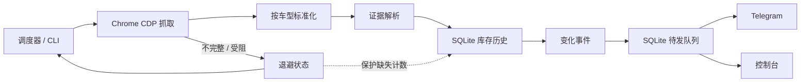
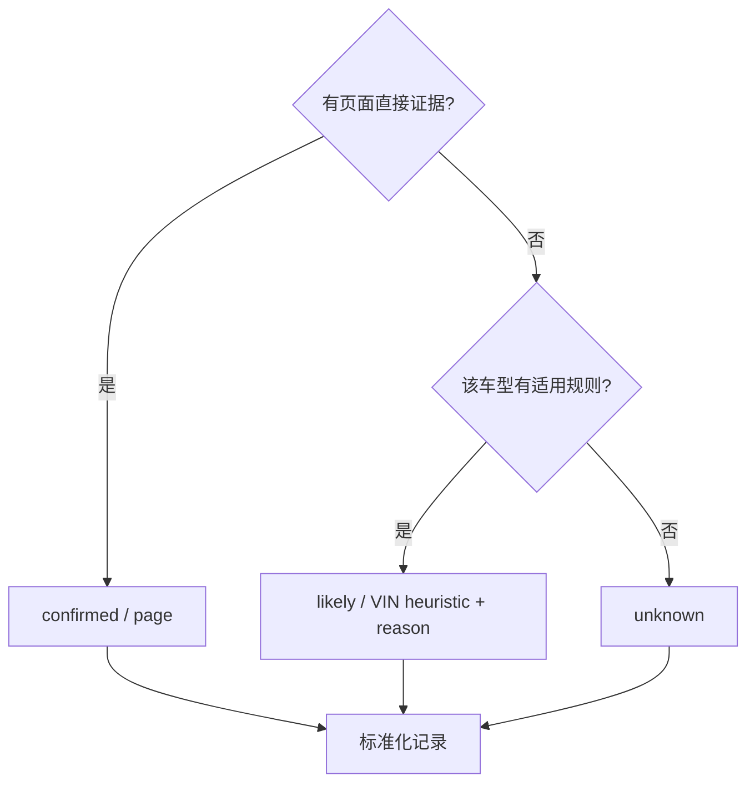

# 架构说明

[English](architecture.md) · [README](../README.zh-CN.md) · [证据规则](filters.zh-CN.md)

YRadar 是本地单进程库存监控工具。工程目标是在上游页面或通知渠道不可靠时，仍保存可信的库存状态。



## 扫描生命周期

1. CLI 可单次运行、按配置间隔循环、发送摘要或输出隔离的离线演示。
2. 独立的系统 Chrome 资料目录通过 CDP 打开 Tesla 官方 Model Y 与 Model 3 库存。
3. 抓取结果标准化为统一记录，同时保留车型、来源与理由。
4. 先解析页面/API 直接证据，再应用车型专属 VIN 启发式。
5. 完整扫描更新库存与缺失计数；不完整扫描可以保存已发现车辆，但不能推进下架状态。
6. 变化事件进入持久化 SQLite 待发队列，再发往 Telegram 或输出到控制台。

## 为什么不完整扫描要特殊处理

空响应有歧义：可能真的没有库存，也可能只是请求被阻断。因此 YRadar 把“扫描是否完整”与“发现了哪些车辆”分开保存。

| 扫描结果 | 保存已发现车辆 | 增加缺失次数 | 发出下架事件 |
|---|---:|---:|---:|
| 完整 | 是 | 是 | 达到连续缺失阈值后 |
| 403 / Access Denied | 若已解析则保存 | 否 | 否 |
| 其他不完整失败 | 若已解析则保存 | 否 | 否 |
| 单车详情核验不明确 | 保留/跳过该 VIN | 该 VIN 不增加 | 该 VIN 不发出 |

这样会让阻断明确暴露，但不会把网络失败变成全库存“已售”。没有直接证据时，界面使用“不再列出”。

## 证据优先级

每个硬件/配置结论都应回答：值是什么、来源是什么、可信状态是什么。



解析器不得把 Model Y 的 2023 流水号阈值用于 Model 3。VIN `S` 只确认 2025 年款，不能单独确认硬件。直接证据冲突时应显示冲突，而非用启发式静默覆盖。

## SQLite 状态与待发队列

SQLite 保存最近库存状态、价格变化输入、缺失计数与通知任务。状态变化和对应待发项一起提交，进程退出时不会有意留下“状态已记录但通知未排队”的裂缝。

通知是 **at-least-once（至少一次）** 语义：成功写回前，待发项一直保留，重启后继续重试。如果 Telegram 已接受消息，但进程在记录成功前退出，重试可能造成重复提醒。对高价值库存提醒而言，偶尔重复优于静默丢失。

事件键可避免正常流程重复入队，但跨外部服务边界无法提供 exactly-once。

## 运费与距离

运费保留来源：Tesla 直接值、按 Tesla 里程档估算、未知。未知不会变成零。价格展示方式与是否把运费用于排序是两个独立设置。

距离使用配置坐标与城市坐标表计算大圆距离，是近似直线距离而非导航路线。坐标缺失时向下传播为未知，不虚构本地距离。

## 故障与恢复

| 现象 | 含义 | 处理 |
|---|---|---|
| Access Denied / 403 | Tesla 阻断当前请求/会话 | 退避；持续发生时运行 `python warmup_tesla.py` |
| 找不到 Chrome | 系统 Chrome 探测失败 | 安装支持的 Chrome 或检查标准路径 |
| 距离/运费未知 | 缺少坐标或运费证据 | 配置坐标或查看 Tesla 页面 |
| Telegram 失败 | 网络、凭据或服务拒绝 | 保持待发并重试；查看已脱敏日志 |
| 重复提醒 | 至少一次重试遇到不确定确认 | 对照事件/VIN/时间；运行时不要手工删除队列 |
| 失败扫描后没有下架 | 有意的不完整扫描保护 | 等待完整扫描 |

## 离线演示与测试

`python monitor.py --demo` 使用合成记录，不访问浏览器、网络或凭据，并使用不访问数据库；它不会触碰用户库存数据库。

离线单元测试应覆盖车型路由、证据优先级、未知传播、阻断保护、连续缺失、运费来源、队列重试和演示隔离：

```bash
python -m unittest discover -s tests -v
```

项目不宣称性能基准或覆盖率。实时行为取决于 Tesla 当前页面，预热后需在本机核验。

## 隐私与发布边界

公开包按白名单复制。运行数据库、`.env`、令牌、chat ID、Cookie、Chrome 资料、日志、缓存、截图、成交细节、完整 VIN 示例、Git 历史和未审查图片都不应进入发布包。
