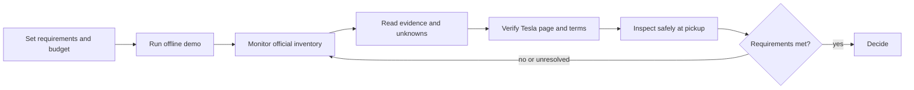

# A practical Tesla used-car workflow

[中文](buyers-guide.zh-CN.md) · [Evidence rules](filters.md) · [Architecture](architecture.md)

This guide turns alerts into a repeatable buying process. It is personal research guidance, not financial, legal, warranty, or mechanical advice. Tesla's inventory, terms, warranties, inspection claims, and transport rules can change; verify the current listing and [Tesla's official pre-owned ordering page](https://www.tesla.com/support/ordering-pre-owned-tesla) before paying.

## 1. Decide before the alert arrives

Separate requirements from preferences. A cheap listing is not a good deal if it fails a requirement or creates a cost you did not budget.

| Decision | Hard requirement example | Preference example |
|---|---|---|
| Model | Model Y cargo space | Model 3 efficiency and smaller footprint |
| Drivetrain | AWD for your use case | Performance acceleration |
| Cabin | Five or seven seats | White interior |
| Range/charging | Minimum usable range | Newer charging curve |
| Mileage | ≤75,000 miles | Under 40,000 miles |
| Condition | No reported repaired status | Minor cosmetic wear acceptable |
| Budget | Maximum all-in cash exposure | Target sticker price |

YRadar's default **Long Range AWD / White Interior / Clean** watch is only a starting profile. Focus and HW4 tiers can alert on cars without white interior. Change thresholds before running the loop.

## 2. Model Y and Model 3 are not the same lookup

Both models use Tesla official inventory and the same change pipeline. Model Y currently has deeper VIN/hardware adaptation because its 2023 plant and serial observations were central to the original hunt.

| Area | Model Y | Model 3 |
|---|---|---|
| Inventory/change tracking | Supported | Supported |
| Page configuration evidence | Supported | Supported |
| Year-code decoding | Supported | Supported |
| 2023 plant/serial heuristics | Model Y-specific | Do not reuse Model Y thresholds |
| Matrix/HW guidance | Deeper, still heuristic | Prefer page/photos; unknown when unsupported |

Never turn a Model Y serial rule into a universal Tesla rule. Unknown is a useful result: it tells you exactly what to verify.

## 3. Understand model year, build date, and hardware

VIN position 10 identifies **model year**, not the exact production date. Calendar year, model year, registration date, and first-use date may differ.

| Model year | Practical interpretation |
|---|---|
| 2022 | Older hardware is more common; evaluate price, warranty, and condition rather than rejecting by year alone |
| 2023 | Transition period; Model Y hardware and headlights need evidence and model-specific caveats |
| 2024 | Newer-year signal, but still verify the individual vehicle |
| 2025 | VIN code `S` confirms model year only; it does not by itself prove HW4 or matrix headlights |

Treat HW generation and matrix headlights as separate questions. A page statement or clear photo is stronger than a VIN heuristic. For 2023 Austin Model Y below `PA160000`, the author's shopping observation suggests roughly 20% may still have matrix lights. That figure is not statistically validated and must not exclude a car automatically.

Useful verification questions:

- What exact configuration does the order page show today?
- Is the hardware/light claim directly listed, visible in photos, or only inferred from VIN?
- Which evidence source produced the label, and is its confidence confirmed, likely, or unknown?
- Can the delivery location confirm the feature before pickup?
- If a feature matters enough to cancel, is that condition written into anything you can rely on?

## 4. Wheels and tires need separate checks

Wheel diameter is a configuration signal. It does **not** reveal tire tread depth, age, brand, damage, alignment, or remaining life. Larger wheels may affect ride, efficiency, replacement cost, and curb-damage exposure.

At pickup, visually check that all four wheel sizes match the listing, tires are appropriate and consistent, warning lights are absent, and obvious cuts, bulges, or severe uneven wear are not present. Ask a qualified technician when condition is uncertain; do not perform risky under-vehicle or high-voltage inspection yourself.

## 5. Read history language literally

`Clean` in YRadar means the observed Tesla query/report did not report accident or repaired status. It is not a title certificate or proof of no prior paint/body work.

| Label | Safe interpretation |
|---|---|
| Clean/none reported | No negative state appeared in the fields YRadar observed |
| Repaired Pre-Owned | Tesla's listing reports repaired status; inspect details carefully |
| Unknown | The relevant field/evidence was missing or conflicting |

Request available history, compare panel gaps and paint in normal light, and consider an independent inspection where permitted. Do not convert “not reported” into “never happened.”

## 6. Compare the real budget

YRadar distinguishes sticker price, direct/estimated transport, and unknown transport. `total` is still only a comparison total.

**Fictional example, not the author's purchase:**

| Item | Vehicle A | Vehicle B |
|---|---:|---:|
| Sticker | $31,800 | $32,400 |
| Transport | $1,000 estimated | $0 direct |
| YRadar comparison | $32,800 | $32,400 |
| Tax/registration/order/insurance/finance | Check separately | Check separately |

Vehicle A has the lower sticker but not the lower comparison cost. An unknown fee should remain unknown and normally still notify, so you can inspect it instead of silently treating it as free.

Also budget for tires, charging setup, insurance, registration, financing, and time/travel. Do not chase the lowest price without checking condition, warranty, transport, and feature confidence.

## 7. Verify official terms and warranty

Tesla's official used-order page currently describes its inspection, warranty, ordering, delivery, and transport framework. Read the current page rather than relying on a screenshot or this guide: [Ordering a pre-owned Tesla](https://www.tesla.com/support/ordering-pre-owned-tesla).

For every candidate, record the exact terms shown on its page:

- remaining original new-vehicle warranty, if any;
- any used-vehicle warranty and when it begins;
- battery/drive-unit warranty term and mileage limit shown for that VIN/configuration;
- transport status and whether a charge is refundable;
- order fee, delivery location, and cancellation/refund language;
- included equipment, keys, charging items, and software packages.

Do not assume all model years or trims share the same battery warranty. The page-specific dates and mileage limits control your comparison.

## 8. Interpret alert timing correctly

YRadar polls on a configurable schedule; the default is 15 minutes. A notification is created after a scan completes and delivery can add delay. It is not a seconds-level feed and cannot prove when Tesla first listed the car.

A 403 or Access Denied response triggers backoff. Partial scans keep discovered rows but do not advance disappearance decisions. “No longer listed” requires consecutive complete misses and does not necessarily mean sold.

When an alert arrives:

1. Open the Tesla link and confirm it is still orderable.
2. Compare current page fields with the alert evidence.
3. Check transport, location, and warranty terms.
4. Apply your hard requirements before the price excitement.
5. Save only the records you need, with personal data handled privately.

## 9. Pickup checklist

Bring the current listing/order details and inspect in safe, normal viewing conditions.

- Verify VIN against your order without publishing it.
- Confirm trim, drivetrain, seating, interior, exterior color, wheels, and included features.
- Review displayed mileage and warning messages.
- Inspect body panels, glass, lamps, cameras, wheels, and tires visually.
- Test doors, windows, seats, climate controls, screen, audio, charging-port door, and supplied keys/cards.
- Confirm included charging/accessory items and delivery paperwork.
- Ask staff to document unresolved issues before acceptance.
- Avoid opening high-voltage components, lifting the car, crawling beneath it, or attempting repairs at pickup.

## 10. A disciplined decision rule

Use three columns for the final comparison: **confirmed**, **likely**, and **unknown**. Price the known costs, list the unknown costs, and decide which unknowns must be resolved before ordering or pickup.

The goal is not to win every alert. It is to recognize the right car quickly, understand what is known, and avoid paying for an assumption.
