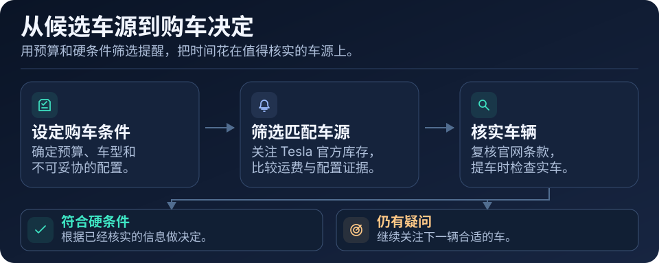

# Tesla 官方二手车实用购买流程

[English](buyers-guide.md) · [证据规则](filters.zh-CN.md) · [架构说明](architecture.zh-CN.md)

这份指南把库存提醒变成可重复的购车流程。它是个人研究经验，不构成财务、法律、保修或机械建议。Tesla 的库存、条款、保修、检查说明与运输规则会变化；付款前请核对具体车源，并阅读 [Tesla 官方二手车订购页面](https://www.tesla.com/support/ordering-pre-owned-tesla)。

## 1. 在提醒到来前先做决定

把硬性条件与偏好分开。价格便宜但不符合硬条件，或带来未计入的成本，就不一定是好交易。

| 决策 | 硬性条件示例 | 偏好示例 |
|---|---|---|
| 车型 | Model Y 的装载空间 | Model 3 的效率与较小车身 |
| 驱动 | 使用场景需要 AWD | 偏好 Performance 加速 |
| 座舱 | 必须五座或七座 | 白色内饰 |
| 续航/充电 | 最低可用续航 | 较新的充电曲线 |
| 里程 | ≤75,000 英里 | 希望低于 40,000 英里 |
| 状态 | 不接受报告为 repaired | 可接受轻微外观磨损 |
| 预算 | 全部现金支出上限 | 目标标价 |

YRadar 默认的 **Long Range AWD / White Interior / Clean** 只是一个起点。Focus 与 HW4 档也能提醒非白内饰车辆。启动循环前先按自己的需求改阈值。

## 2. Model Y 与 Model 3 不是同一套查表

两种车型共享 Tesla 官方库存与变化检测流程。Model Y 目前 VIN/硬件适配更深，因为原始购车研究重点包含它的 2023 工厂与流水号变化。

| 范围 | Model Y | Model 3 |
|---|---|---|
| 库存与变化监控 | 支持 | 支持 |
| 页面配置证据 | 支持 | 支持 |
| VIN 年款码 | 支持 | 支持 |
| 2023 工厂/流水号 | 仅适用于 Model Y 的规则 | 不套用 Model Y 阈值 |
| 矩阵/HW 提示 | 更深入，但仍是启发式 | 优先看页面/照片；不支持时为 unknown |

不要把 Model Y 流水号规则当成 Tesla 通用规则。`unknown` 不是失败，而是明确告诉你下一步需要核实什么。

## 3. 分清年款、生产日期和硬件

VIN 第 10 位表示**年款**，不是精确生产日期。自然年、年款、注册日期与首次使用日期可能不同。

| 年款 | 实用理解 |
|---|---|
| 2022 | 较旧硬件更常见；应结合价格、保修和车况，而非只凭年份淘汰 |
| 2023 | 过渡期；Model Y 硬件与灯光需要证据和车型专属边界 |
| 2024 | 较新年款信号，仍需核实具体车辆 |
| 2025 | VIN `S` 只确认 2025 年款，不能单独证明 HW4 或矩阵大灯 |

HW 代际与矩阵大灯是两个独立问题。页面明确说明或清晰照片比 VIN 推断更强。对 2023 Austin Model Y、`PA160000` 以下车辆，作者购车观察认为仍约 20% 可能配矩阵灯；这个数字未经统计验证，不能自动排除车辆。

可以这样向交付点或卖方核实：

- 当前订单页面显示的准确配置是什么？
- 硬件/灯光结论来自页面文字、照片，还是只来自 VIN 推断？
- 标签的证据来源是什么，置信状态是 confirmed、likely 还是 unknown？
- 提车前能否由交付点确认该功能？
- 如果该配置重要到足以取消，是否有可依赖的书面条件？

## 4. 轮毂尺寸和轮胎寿命要分开看

轮毂直径是配置线索，但不能说明轮胎花纹深度、年龄、品牌、损伤、定位或剩余寿命。大轮毂还可能影响舒适性、能耗、更换成本和剐蹭风险。

提车时可目视核对四个轮毂尺寸与页面一致、轮胎规格合理且整体一致、没有警告灯，以及没有明显割伤、鼓包或严重偏磨。状态不确定时请咨询合格技师；不要自行进行车底或高压系统等高风险检查。

## 5. 严格按字面理解历史标签

YRadar 的 `Clean` 只表示观察到的 Tesla 查询/字段没有报告事故或 repaired 状态，不是产权证书，也不能证明从未补漆或维修。

| 标签 | 安全理解 |
|---|---|
| Clean/none reported | YRadar 观察的字段没有出现负面状态 |
| Repaired Pre-Owned | Tesla 页面报告维修车状态，应仔细检查细节 |
| Unknown | 相关字段缺失或证据冲突 |

索取可用历史，在正常光线下比较钣金缝隙和漆面；条件允许时考虑独立检查。不要把“未报告”改写成“从未发生”。

## 6. 用一致口径比较预算

YRadar 区分标价、直接/估算运费和未知运费。`total` 仍只是比较总价。

**下面是虚构示例，不是作者成交信息：**

| 项目 | 车辆 A | 车辆 B |
|---|---:|---:|
| 标价 | $31,800 | $32,400 |
| 运费 | $1,000 估算 | $0 直接值 |
| YRadar 比较价 | $32,800 | $32,400 |
| 税/注册/订单/保险/贷款 | 另查 | 另查 |

车辆 A 标价更低，但比较成本更高。未知运费应保持未知，并通常仍然通知，让你主动核实，而不是静默当成免费。

还要预算轮胎、家庭充电、保险、注册、贷款和时间/差旅成本。不要只追最低价而忽略车况、保修、运输和配置可信度。

## 7. 核对官方条款与保修

Tesla 官方二手车页面目前介绍其检查、保修、订购、交付与运输框架。请阅读当前页面，不要依赖截图或本指南：[订购 Tesla 二手车](https://www.tesla.com/support/ordering-pre-owned-tesla)。

对每辆候选车记录页面显示的具体条件：

- 原新车保修还剩多少（如有）；
- 二手车保修内容及起算时间；
- 该 VIN/配置页面显示的电池与驱动单元期限和里程上限；
- 运输状态及相关费用能否退款；
- 订单费、交付地点、取消和退款规则；
- 随车设备、钥匙、充电物品和软件包。

不要假设不同年款或配置有相同的电池保修，以具体页面的日期与里程为准。

## 8. 正确理解提醒时延

YRadar 按可配置周期轮询，默认 15 分钟。通知在扫描结束后创建，消息渠道还会增加延迟。它不是秒级数据流，也不能证明 Tesla 首次发布车辆的准确时间。

403 / Access Denied 会触发退避。不完整扫描会保留已发现车辆，但不推进下架判断。“不再列出”需要连续完整扫描缺失，并不一定表示已售。

收到提醒后：

1. 打开 Tesla 链接，确认仍可下单。
2. 对照提醒证据与当前页面字段。
3. 查看运输、地点与保修条款。
4. 先应用硬性条件，再考虑价格吸引力。
5. 只保存必要记录，并私密处理个人数据。

## 9. 提车检查清单

带上当前车源/订单说明，在安全、正常光线下检查。

- 核对 VIN 与订单一致，但不要公开 VIN。
- 确认配置、驱动、座椅、内外饰、轮毂与包含功能。
- 查看表显里程与警告信息。
- 目视检查车身、玻璃、灯、摄像头、轮毂和轮胎。
- 测试车门、车窗、座椅、空调、屏幕、音响、充电口盖与钥匙/卡片。
- 核对随车充电/配件和交付文件。
- 接受车辆前，请工作人员记录未解决问题。
- 不要拆高压部件、举升车辆、钻到车底或在现场自行维修。

## 10. 用纪律替代抢购焦虑

最终比较表用三列：**confirmed、likely、unknown**。计算已知成本，列出未知成本，并决定哪些未知项必须在下单或提车前解决。

目标不是抢赢每一条提醒，而是在合适车辆出现时快速识别它，同时知道哪些是事实、哪些仍是假设。
