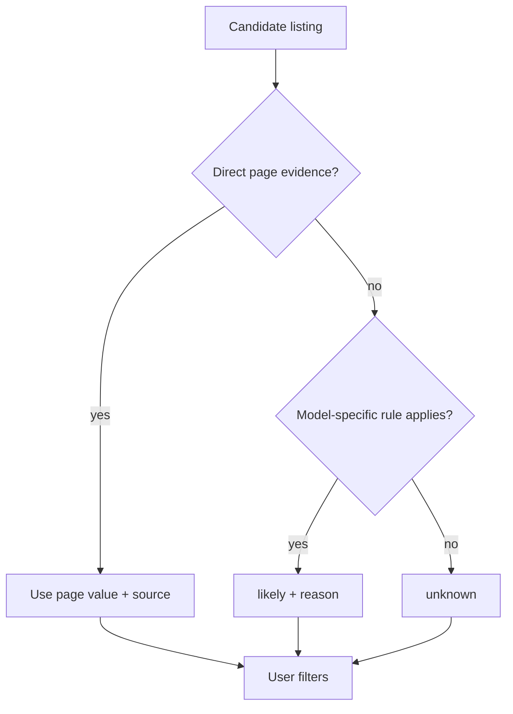

# Filters and evidence

[中文](filters.zh-CN.md) · [Buyer's guide](buyers-guide.md) · [README](../README.md)

YRadar separates observation from inference. A Tesla page/API value is `page`; a decoded VIN value is `vin`; a model-specific rule is `heuristic`. Prefer direct page evidence, then model-specific inference, otherwise `unknown`.

| Field | Meaning | Never infer |
|---|---|---|
| `confirmed` | Direct, unambiguous page/listing evidence | From model year alone |
| `likely` | Model-specific heuristic with a reason | Across Model Y and Model 3 |
| `unknown` | Evidence missing or conflicting | Zero, absent, or false |

## Default profile

Defaults are editable, not buying advice: models `my,m3`; model year 2023+; mileage ≤75,000; and a watch label of **Long Range AWD / White Interior / Clean**.

`Clean` means no accident/repaired state was reported in the observed Tesla fields or selected Tesla query. Unknown history remains unknown; this label does not certify title, paintwork, structural condition, or prior damage.

## Hardware rules

| Input | Result |
|---|---|
| VIN position 10 `S` | Confirms model year 2025 only |
| 2025 model year without page evidence | HW4/matrix remain `likely` or `unknown`, never confirmed solely by year |
| 2023 Austin Model Y below `PA160000` | Matrix status is uncertain; author's unvalidated observation says about 20% may still have matrix |
| Model 3 | Never apply Model Y 2023 plant/serial thresholds |

The Austin observation is shopping experience, not a statistically verified rate, and must not hard-filter a vehicle. Verify via photos, listing text, service information, or inspection.

## Fees, distance, and state changes

Transport fee source is either Tesla's direct fee, an estimate from Tesla mileage bands, or unknown. Unknown is not `$0`. `net_plus_fee` shows the components; `total` adds known/estimated transport for comparison. `INCLUDE_TRANSPORT_IN_SORT` controls sorting separately.

Distance is great-circle distance from configured coordinates to the listing city coordinate. It is approximate and not a road route. If coordinates are unavailable, distance and fee estimates stay unknown.

A listing becomes “no longer listed” only after at least two consecutive complete scans miss it. It is not called sold without direct evidence. A partial/blocked scan cannot advance the miss count.

The default scan interval is 15 minutes and is configurable. Alerts are scan-completion notifications, not a seconds-level feed and not proof of when Tesla first published a listing.
